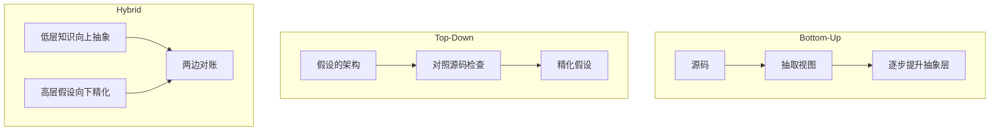

Software Architecture Reconstruction（软件架构重构），从已有系统反推出架构描述的一支。它是 [[Sensemaking]] 在软件工程里的专门化——representation（表示）具体化成 architecture view（架构视图）。

存在的理由是一句被反复引用的观察，Symphony 论文的开场：**「Far too often, architecture descriptions of existing systems are out of sync with the implementation. If they are, they must be reconstructed.」** 架构描述与实现脱节是常态，不是例外。Ducasse & Pollet 把根因说得更直接：**架构和类、包不一样，它在代码里没有显式表示**，所以只能重构，不能读取。

## 出身与定位

这一支的术语底座是 Chikofsky & Cross 1990 的分类（*IEEE Software*），它定义并厘清了六个词的关系。SAR 落在 reverse engineering（逆向工程）之下：

| 术语 | 含义 |
|---|---|
| **Forward engineering**（正向工程） | 从抽象往实现走，正常开发 |
| **Reverse engineering**（逆向工程） | 分析目标系统，识别构件与其关系，**建立更抽象的表示** |
| **Redocumentation**（再文档化） | 逆向工程的子域，目标是**恢复丢失或从未存在的文档** |
| **Design recovery**（设计恢复） | 逆向工程的子集，额外引入领域知识、外部信息与推断，识别有意义的高层抽象 |
| **Restructuring**（重构） | 同一抽象层内改形式，不改行为 |
| **Reengineering**（再工程） | 审视并改造系统使其成为新形式，再实现该新形式 |

**SAR 是 design recovery 的架构层版本**，而不只是 redocumentation。区别关键：redocumentation 只求把已有事实写下来，design recovery 承认**必须引入代码里没有的外部知识**才能得到有意义的抽象。这条界线在后面反复出现——它是这一支所有难题的根源。

### 与 sensemaking 的对应

| Sensemaking 的环节 | SAR 里是什么 |
|---|---|
| foraging loop | 抽取源视图：解析代码、建 AST、查依赖 |
| schematize | 把源视图映射成架构视图 |
| schema / frame | 架构视图本身 |
| residue | 映射不上的元素——divergence 与 absence（见下） |

文献自己认领了这层关系，有论文题目就叫 *Software reverse engineering as a sensemaking task*。

## 三种视图

Symphony（van Deursen, Hofmeister, Koschke, Moonen & Riva 2004, WICSA）的核心贡献之一是把视图分成三类。三个定义都是原文的：

| 视图 | 原文定义 | 从哪来 |
|---|---|---|
| **Source view**（源视图） | *a view of a system that can be extracted from artifacts of that system* | 源码、build 文件、配置、文档、运行轨迹 |
| **Target view**（目标视图） | *describes the as-implemented architecture and contains the information needed to solve the problem* | 由 source view 经 mapping rules（映射规则）推出 |
| **Hypothetical view**（假设视图） | *describes the architecture of the system, but perhaps not accurately* | 访谈系统专家、翻已有文档 |

三者的分工值得说清，因为 hypothetical view 最容易被忽略：

- **Source view** 可以低到不像架构——原文明说它可以覆盖 AST（抽象语法树）与控制流图。
- **Target view** 描述的是 **as-implemented**（实际实现的）架构，不是 as-designed（设计时的）。这个限定是刻意的：SAR 的产物是「它现在是什么样」，不是「它本该是什么样」。
- **Hypothetical view** 明确允许不准确。它有两种用法：当规范（检查实现是否合规），或当向导（表达当前理解，用来引导重构过程）。

**Hypothetical view 是这一支处理「先验知识」的正规机制。** 承认自己对系统已有一套猜测，把它写下来当成可被推翻的对象，而不是让它隐含地影响结论。Symphony 的 Cobol 案例里，供应商的文档与演示就充当 hypothetical view，用来设计 target model 并寻找架构违规。

## 三种过程

Ducasse & Pollet 2009（*IEEE TSE* 35(5):573–591）的 process-oriented taxonomy（面向过程的分类）把 SAR 方法按过程分三类，定义均出自原文：

| 过程 | 起点 | 别名 | 代表工具 |
|---|---|---|---|
| **Bottom-up** | 低层知识，逐步升抽象 | architecture recovery（架构恢复） | Dali、Softwarenaut、ARMIN |
| **Top-down** | 高层知识（需求、架构风格），提出假设再对照代码 | architecture discovery（架构发现） | **RMTool**（Reflexion Model）、SAVE、W4 |
| **Hybrid** | 两头同时做，中间对账 | —— | **Symphony**、Bauhaus、Focus |

Bottom-up 的经典循环叫 **extract-abstract-present**（抽取—抽象—呈现，Tilley et al.）：源码分析填充 repository，查询它得到抽象表示，再以可交互形式呈现给逆向工程师。

**Hybrid 是主流**，Ducasse & Pollet 表格里 34 个方法有 15 个是 hybrid。原因是它「reconcile the conceptual and concrete architectures」——调和概念架构与具体架构，因此常被用来阻止 architectural erosion（架构侵蚀）。

技术还有一条正交的自动化程度轴，同样是原文定义：

| 级别 | 谁在控制 |
|---|---|
| **Quasi-manual**（准手工） | 人手工识别架构元素，工具只帮他理解发现 |
| **Semi-automatic**（半自动） | 人手工指示工具**怎么**自动发现精化或恢复抽象 |
| **Quasi-automatic**（准自动） | 工具掌握控制权，人**掌舵**迭代恢复过程 |

注意最高级别也不是全自动——原文的词是 steers（掌舵），人始终在环里。

## Symphony：两阶段五步

Symphony 的主张是 **view-driven**（视图驱动）加 **problem-driven**（问题驱动）：它填补的空白是「已有大量重构单个视图的技术，但没有关于**怎么选视图**、以及重构过程本身的信息」。

两个阶段，五个步骤：

| 阶段 | 步骤 | 做什么 |
|---|---|---|
| **Reconstruction Design**（重构设计） | Problem Elicitation（问题引出） | 与 stakeholder 一起分析触发重构的问题 |
| | Concept Determination（概念确定） | 识别与问题相关的架构概念，定恢复策略 |
| **Reconstruction Execution**（重构执行） | Data Gathering（数据收集） | 分析系统，抽取 source view |
| | Knowledge Inference（知识推断） | 应用 mapping rules |
| | Information Interpretation（信息解释） | 填充 target view，交付解释 |

两阶段**迭代**：执行会揭示新的重构机会，反过来精化对问题的理解与重构设计。原文明说 source viewpoints、target viewpoints、mapping rules 三者都在过程中演化。

两个阶段的产物不同，这点常被忽略：

- **Reconstruction Design 产出的是一套明确定义的重构程序**，其价值超出本次重构——可用于持续的架构合规检查与未来的重构。
- **Reconstruction Execution 产出的是架构描述**，用来解决触发本次重构的那个问题。

### Problem Elicitation 的门槛

这一步的实质是**先证明这次重构值得做**。原文的理由很实在：重构需要架构专家和 stakeholder 代表（测试、开发、管理层、业务方、用户）的深度参与，而这些人通常在别处也被强需求，**所以必须有一个 compelling reason（充分理由）才能启动**。

典型理由：性能问题、维护成本高、可靠性差、系统替换或扩展的考量。这些先收进一份一到两页的备忘录，给出管理视角。

原文特别提醒一点：**备忘录与初始问题陈述可以是「architecture-agnostic」（与架构无关）的**——它们必须用 stakeholder 熟悉的语言表达。把「感知到的问题」翻译成架构概念，是下一步 Concept Determination 的职责，不能混在这一步做。

techniques 包括结构化工作坊、检查清单、角色扮演、场景分析。原文的一个具体做法：开一个所有 stakeholder 都参加的工作坊，请每个人讲他与该系统**最好和最坏的一次经历**。

## Reflexion Model：把落差算出来

Murphy、Notkin & Sullivan 1995（FSE）的 software reflexion model 是 top-down 那一支的正典，也是整个 SAR 里**机制最干净**的一个。

做法三步：

1. 人定义一个 high-level model（高层模型）——任务相关的结构假设
2. 人指定这个模型**怎么映射到**源码
3. 工具计算出 reflexion model，显示高层模型与源码在哪里一致、在哪里不一致

它的产物是三类判定：

| 判定 | 含义 |
|---|---|
| **Convergence**（收敛） | 该元素在两个视图里都存在 |
| **Divergence**（分歧） | 只在具体视图（源码）里存在 |
| **Absence**（缺失） | 只在概念视图（假设）里存在 |

人反复计算并解释 reflexion model，直到满意。

**这个机制值得单独记住的原因**：它不试图自动产出架构，而是**把人的假设与代码的差异量化出来**。假设可以很粗，粗的假设照样能算出有用的差异——原文的说法是让工程师「用一个任务相关的高层模型当透镜」去看源码。

对照 [[Sensemaking]] 的 residue（残留）概念：**divergence 与 absence 就是 residue 的形式化**。它们不是错误报告，是「你的 frame 需要改」的信号。这是四支里唯一把 residue 做成一等产物的做法。

## 六种输入

Ducasse & Pollet 的分类里，SAR 的输入远不止源码。这份清单本身有用——它提示了容易被漏掉的信息源：

| 输入 | 例子 |
|---|---|
| **Source code**（源码） | —— |
| **Textual information**（文本信息） | 注释、文档、命名 |
| **Dynamic information**（动态信息） | 运行轨迹、profiling |
| **Physical organization**（物理组织） | 目录结构、build 配置 |
| **Human organization**（人的组织） | 谁负责哪块——康威定律的逆用 |
| **Historical information**（历史信息） | 版本历史、变更耦合 |
| **Human expertise**（人的专长） | 访谈系统专家 |

**Historical information 与 human organization 这两项，纯静态分析的工具全都用不上，而它们往往信息量最大。** 谁在改哪些文件、哪些文件老是一起变，这些答案在 git 历史里，不在代码里。

## 可信边界

**Abstraction gap 是这一支的中心难题，且没有被解决。** 从 source view 到 target view 的落差要靠 mapping rules 跨，而规则得人写。Ducasse & Pollet 的自动化分级里最高一级仍然是「工具掌握控制权，人掌舵」——**没有「人不在环里」这一级**。三十多年文献没有改变这一点。

**Target view 只答「现在是什么样」。** 它是 as-implemented 的，不回答为什么这么设计、本该是什么样。后者要靠 hypothetical view 从人那里拿，而人可能已经走了、文档可能已经错了。这是 design recovery 必须引入外部知识的根本原因。

**Mapping rules 会随代码演化失效**，而失效通常是静默的。这使得 SAR 的产物有保鲜期，一次性重构的价值会衰减——Symphony 因此强调 Reconstruction Design 的产物（那套程序）比 Execution 的产物（那份描述）更耐用。

**成本高到需要论证。** Symphony 自己要求启动前先有 compelling reason 加一份管理层备忘录。这不是流程官僚，是承认 stakeholder 的时间贵。轻量场景下这一支的多数步骤会退化。

**工具生态碎片化。** Ducasse & Pollet 表格里 34 个方法，绝大多数是研究原型，没有一个成为工业标准。这一支的知识主要以方法论形式存在，不以可用工具形式存在。

## 相关链接

- [Symphony: View-Driven Software Architecture Reconstruction](https://www.clody.org/research/2004_duersen_riva_wicsa.pdf)（van Deursen, Hofmeister, Koschke, Moonen & Riva 2004, WICSA）
- [Software Architecture Reconstruction: A Process-Oriented Taxonomy](https://inria.hal.science/inria-00498407v1/file/Duca09c-TSE-SOAArchitectureExtraction.pdf)（Ducasse & Pollet 2009, *IEEE TSE* 35(5):573–591）
- [Software Reflexion Models: Bridging the Gap Between Source and High-Level Models](https://www.cs.ubc.ca/~murphy/papers/rm/fse95.html)（Murphy, Notkin & Sullivan 1995, FSE）
- [Reverse Engineering and Design Recovery: A Taxonomy](https://dl.acm.org/doi/10.1109/52.43044)（Chikofsky & Cross 1990, *IEEE Software*）
- [Software reverse engineering as a sensemaking task](https://www.researchgate.net/publication/233895777_Software_reverse_engineering_as_a_sensemaking_task)
