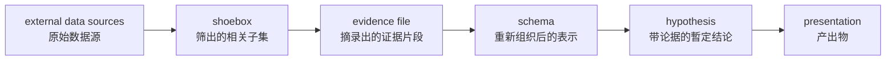

Russell、Stefik、Pirolli 与 Card 1993 年在 CHI 上给的定义是一句话：**「the process of searching for a representation and encoding data in that representation to answer task-specific questions」**——为回答特定问题，找一个 representation（表示），再把数据编码进去。

关键在**表示要自己找**。数据摆在那儿不会自己成形，得先决定用什么结构装它——时间线、分类表、层级、因果链——然后才能往里装。装的过程中会发现装不进去的东西（原文叫 residue，残留），那正是要改表示的信号。

## 三支传统同名不同源

**「sensemaking」这个名字底下有三支独立传统**，各自的源头、学科、关心的问题都不同。混用会出错，因为它们连「什么算做完」都不一样：

| 传统 | 提出者 | 学科 | 核心问题 |
|---|---|---|---|
| **Sense-Making Methodology** | Dervin 1970s— | library & information science（图书馆与信息科学） | 人遇到 gap（缺口）时怎么找信息填补 |
| **Organizational sensemaking** | Weick 1995 | organization studies（组织研究） | 组织怎么集体地把混沌变成可行动的说法 |
| **Sensemaking（HCI 那支）** | Russell et al. 1993、Pirolli & Card 2005 | HCI / cognitive systems engineering | 个人分析员怎么为大量数据找表示 |

外加一支与第三支关系最近的：**Klein 的 data/frame theory**（macrocognition，宏观认知），下面单说。

**本族页讲的是第三支**，因为它关心的正是「一堆数据怎么变成结构」。另外两支的要点：

- **Dervin** 的模型是 situation（处境）→ gap（缺口）→ use（用途）三元组，配套方法叫 Micro-Moment Time Line Interview（微观时刻时间线访谈）。她坚持用动词而非名词描述信息行为（原文叫 verbing），主张信息不是被找到的东西而是被构造出来的。
- **Weick** 的七条属性中最常被引用的是第七条——**sensemaking 由 plausibility（合理性）驱动而非 accuracy（准确性）**。组织需要的是一个够用的说法好让行动继续，不是最正确的说法。他的过程序列是 enactment（生成）→ selection（选择）→ retention（保留）：组织通过行动**创造出**自己所处的环境，再从中选择解释、保留可用的。

这两支和本仓库的关系较远，但 Weick 那条对写沉淀页有直接警示：**plausibility 驱动是描述性发现，不是规范建议**——它说明人天然会满足于一个说得通的解释，而这正是要靠 [[结构化写作]] 的「可信边界」一节和锚点回验去对抗的。

## 两环模型

Pirolli & Card 2005（Proc. Intl. Conf. on Intelligence Analysis）用 CTA（cognitive task analysis，认知任务分析）研究情报分析员的实际工作，得出的模型是这一支最常被引用的东西。

数据流分五个存量，从原始信息一路转到可交付物：



原文对这条流的概括是：**把信息从原始状态转导成专业判断能施加的形式，再转成适合沟通的形式。** 两件事，不是一件——很多人只做前半段就以为完了。

两个环套在这条流上：

| 环 | 覆盖哪几步 | 干什么 |
|---|---|---|
| **Foraging loop**（觅食环） | 搜索 → 过滤 → 阅读 → 抽取 | 找信息、筛信息、把片段抽出来 |
| **Sensemaking loop**（意义建构环） | schema → hypothesis → presentation | 从 schema 出发迭代出最合乎证据的心智模型 |

Foraging loop 的理论基础是 Pirolli & Card 1999 的 **information foraging theory**（信息觅食理论），sensemaking loop 来自 Russell et al. 1993 的 **learning loop complex**（学习环复合体）。

### Information foraging theory 的几个概念

IFT 借的是生态学的 optimal foraging theory（最优觅食理论）：动物觅食时权衡在当前 patch 继续找还是换地方，人找信息时也一样。核心概念：

| 概念 | 含义 |
|---|---|
| **Information scent**（信息气味） | 从线索（标题、摘要、链接文字）预判某条路径值不值得走。气味弱就该换方向 |
| **Patch**（信息斑块） | 信息聚集的一块地方（一个文档、一个目录、一次搜索结果） |
| **Diet**（食谱） | 决定处理哪类信息、忽略哪类 |
| **Enrichment**（富集） | 改造环境让信息更好找，而不是改自己的搜法 |

Pirolli & Card 2005 把 foraging loop 描述成三者的权衡：**exploration（探索新 patch）、enrichment（改造当前 patch）、exploitation（榨取当前 patch）**。

对本仓库最有用的是 **enrichment**：与其每次重新搜，不如改造环境让下次好找——`tags`、双链、`wiki list` 这些都是 enrichment 而非 exploration。这解释了为什么维护索引的功夫不是额外开销，是在降低后续每一次觅食的成本。

### 两个方向是机会性混合的

这是全篇最该记住的一条，也是最反直觉的一条。信息处理可以由 bottom-up（自下而上，从数据到理论）驱动，也可以由 top-down（自上而下，从理论到数据）驱动，而 Pirolli & Card 的原话是：**「top-down and bottom-up processes are invoked in an opportunistic mix」**——两者机会性地混着用，不是先做完一个再做另一个。

| 方向 | 子过程（原文术语） |
|---|---|
| **Bottom-up** | search and filter（搜索与过滤）→ read and extract（阅读与抽取）→ schematize（图式化）→ build case（建立论证）→ tell story（讲出来） |
| **Top-down** | re-evaluate（重估）、search for support（找支持）、search for evidence（找证据）、search for relations（找关系）、search for information（找信息） |

Top-down 那五个都是「已有一个想法，回头去数据里找」——由高层的假设触发对低层存量的重新检查。

**这一条解决了「骨架先行 vs 先编码后归类」的伪对立。** [[结构化写作]] 主张先定骨架，QDA 主张先编码让类别浮现，看起来矛盾——实际上两者分别是 top-down 与 bottom-up 的一次调用，而真实工作是两者交替。**纠结该用哪个是问错了问题**，该问的是此刻手上有没有可用的 schema：有就往里装，装不进去（residue）就改 schema。

另有两条容易被忽略的原文提醒：

- 日常工作里**大量「分析」其实只是抽取加重新包装**，没有真正的分析发生。这话是原作者自己写的，用来划清模型的适用边界。
- 专家的 schema 技能在流程的**每一点**都在用，不是只在 schematize 那一步——比如早期快速略读并否掉无关信息，用的也是它。

### Klein 的 data/frame：frame 决定什么算数据

Klein、Moon 与 Hoffman（2006, *IEEE Intelligent Systems*）的 data/frame theory 用 **frame**（框架）扮演 schema 的角色，但它有一个比 schema 更强的主张：

> **A frame is necessary because it specifies what counts as data.**

**frame 决定什么算数据**——不是先有数据后有框架，而是没有框架就分不出什么是数据什么是噪音。原文的例子：同一头牛，对牧场主是牛排，对印度教徒是圣物，对分子生物学家是基因与蛋白质的集合。而且一个人可以**同时持有多个 frame**，通常有一个占主导，但会考虑多个。

围绕 frame 的几条推理路径（原文术语）：

| 过程 | 内容 |
|---|---|
| **Questioning the frame**（质疑框架） | 检测、识别、追踪不一致处，评估 frame 的 plausibility |
| **Elaborating the frame**（充实框架） | frame 看起来站得住时，找更多数据、**丢掉不相关的数据**、探索数据间的新关系 |
| **Reframing**（重构框架） | 质疑之后形成一个替代的 frame |
| **Comparing frames**（比较框架） | 有两个以上竞争 frame 时比较哪个更好 |
| **Preserving the frame**（保留框架） | 经质疑后判定原 frame 仍成立 |

原文给 questioning 加系统性的做法值得抄：**把要问的问题分成几个固定类别**——数据里的异常与不一致、数据本身的合理性、数据来源的合理性、数据质量。这比"仔细想想对不对"可执行得多。

**这一支与 Pirolli & Card 的分工**：后者关心流程与成本（哪步贵、工具能省哪步），前者关心 frame 从哪来、怎么换。两套可互换使用，Pirolli & Card 自己在论文里就点了 Klein 的名，说 frame 扮演的是 schema 的角色。

## 按 representation 分的几支

[[SAR]] 单开了页。另两支的要点记在这里。

### QDA：representation 是主题

**Grounded Theory**（扎根理论，Glaser & Strauss 1967, *The Discovery of Grounded Theory*）不预设理论，让理论从数据里长出来。三个构件：**open coding**（开放编码，逐段贴标签）、**axial coding**（主轴编码，把标签归拢成类别并找关系）、**constant comparison**（持续比较，每读一条新数据都回头修类别）。

停止判据叫 **theoretical saturation**（理论饱和）：新数据不再产生新类别。这个判据务实之处在于**它承认不必读完全部**，但要求读到不再有新东西。

**Thematic Analysis**（主题分析，Braun & Clarke 2006, *Qualitative Research in Psychology* 3(2):77–101）更轻，六阶段：熟悉数据 → 生成初始编码 → 搜索主题 → 检视主题 → 定义命名主题 → 成文。不要求产出理论，只要求主题站得住。

对照两环模型：编码属于 foraging loop 的 read and extract，归类属于 schematize，**theoretical saturation 是 foraging loop 的退出条件**。

### SAR：representation 是架构视图

从已有系统反推架构描述。**这一支已单开页**——三种视图（source / target / hypothetical）、三种过程（bottom-up / top-down / hybrid）、Symphony 的两阶段五步、Reflexion Model 的 convergence / divergence / absence，见 [[SAR]]。

它与本族的关系：抽取源视图对应 foraging loop，映射成架构视图对应 schematize，而 Reflexion Model 的 divergence 与 absence **是 residue 的形式化**——四支里唯一把 residue 做成一等产物的。

### Ontology learning：representation 是概念层级

**Layer cake**（Buitelaar, Cimiano & Magnini 2005）把从文本建本体拆成自下而上若干层，每层输出是下一层输入：

```
terms（术语）→ synonyms（同义词）→ concepts（概念）
  → concept hierarchies（概念层级）→ relations（关系）
  → axioms & rules（公理与规则）
```

越往上自动化越难：抽术语基本可自动，抽公理至今主要靠人。

## 各支共有的两个问题

**一 · 抽象落差没法自动跨。** SAR 叫 abstraction gap，ontology learning 表现为越上层越难自动，QDA 表现为从编码到主题那一步始终靠人判断。在两环模型里，这道落差就落在 foraging loop 与 sensemaking loop 的交界——**schematize 那一步**。各支在同一处卡住，这大概是这个领域最稳的一条经验：低层结构可自动，高层判断不可。

**二 · 断言要能回原文核验。** QDA 要求主题附 data extract（数据摘录），SAR 要求视图能追回源码，AIS（Attributable to Identified Sources，可归因于已识别来源；Rashkin et al. 2023, *Computational Linguistics* 49(4)）把它形式化成生成系统的评估框架：关于外部世界的断言必须能对独立来源核验。

锚点选什么很关键：**坐标（行号、页码）容易记错且原文一改就无声失效，原文片段可以回搜——搜不到就是错，错误自己暴露。** 优先用片段，坐标由回搜算出来。

## 可信边界

**模型描述的是情报分析，不是所有认知工作。** Pirolli & Card 的数据来自情报分析员的 CTA，其杠杆点大多针对**数据过载与注意力管理**。规模不大的场景里，模型的多数环节会退化成一步。

**「找表示」这件事模型本身没解释。** 定义说 sensemaking 是 searching for a representation，但表示从哪儿来、怎么判断一个表示比另一个好，两环模型没答——它描述流程，不给生成方法。Klein 的 frame 理论把答案推给「专业能力积累」，等于承认这一步无法程序化。

**存量划分容易被当成阶段。** shoebox / evidence file / schema 是**存量**不是**阶段**，五个存量同时存在且互相回流。画成一条链是为了讲清转导关系，照着它顺序推进反而违背 opportunistic mix。

## 相关链接

- [The cost structure of sense making](https://dl.acm.org/doi/abs/10.1145/169059.169209)（Russell, Stefik, Pirolli & Card 1993, CHI——定义出处）
- [Data-Frame Model of Sensemaking](http://phibetaiota.net/wp-content/uploads/2014/12/Data-Frame-Model-of-Sensemaking-Moore-and-Hoffman.pdf)（Moore & Hoffman 述 Klein, Moon & Hoffman 2006）
- [Sensemaking in Organizations](https://uk.sagepub.com/en-gb/eur/sensemaking-in-organizations/book4988)（Weick 1995——七条属性）
- [Information foraging theory](https://www.interaction-design.org/encyclopedia/information_foraging_theory.html)（Pirolli & Card 1999 的概述）
- [SenseMaking: A Methodological Perspective](https://www.researchgate.net/publication/238691238_SenseMaking_A_Methodological_Perspective)（Dervin 那一支的概述）
- [The sensemaking process and leverage points for analyst technology](https://andymatuschak.org/files/papers/Pirolli,%20Card%20-%202005%20-%20The%20sensemaking%20process%20and%20leverage%20points%20for%20analyst%20technology%20as.pdf)（Pirolli & Card 2005——两环模型）
- [Software reverse engineering as a sensemaking task](https://www.researchgate.net/publication/233895777_Software_reverse_engineering_as_a_sensemaking_task)
- [The Discovery of Grounded Theory](http://www.sxf.uevora.pt/wp-content/uploads/2013/03/Glaser_1967.pdf)（Glaser & Strauss 1967）
- [Using thematic analysis in psychology](https://www2.uwe.ac.uk/services/Marketing/students/Newstudents/HAS/Using%20thematic%20analysis%20in%20psychology.pdf)（Braun & Clarke 2006）
- [Symphony: View-Driven Software Architecture Reconstruction](https://www.clody.org/research/2004_duersen_riva_wicsa.pdf)（van Deursen et al. 2004）
- [Measuring Attribution in Natural Language Generation Models](https://aclanthology.org/2023.cl-4.2/)（Rashkin et al. 2023，AIS）
