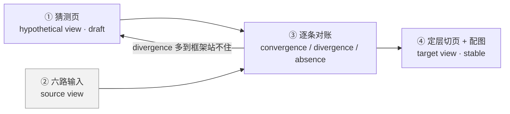

把别人造的系统拆到「能不看源码复述它的构造」的一套流程：**先写猜测 → 取多路输入 → 逐条对账 → 定层切页 → 每节配图**，末了单记一本取舍账。每一轮都拿代码去打自己的猜测，直到打不动为止。

它要解决的不是「这个系统好不好」，而是**「我是不是在编」**。拆外部系统最贵的失败不是漏读，是**写出一段看起来对、代码里却没有的东西**——它和真的长得一模一样，写完就再也发现不了。整套方法的重心都落在这一件事上：让猜测与代码的差异**显式地暴露出来**，而不是被散文糊过去。

## 出身

四份现成的来料，各管一段，都不是自己发明的：

| 来料 | 在这套方法里管什么 |
|---|---|
| [[SAR]]（Symphony 与 Reflexion Model） | **骨干**：三种视图、假设先行、把差异算成 convergence / divergence / absence |
| C4 Model | **图的纪律**：一张图只画一个缩放倍数 |
| Architecture Decision Record | **取舍单独记账**：正文记「是什么」，账本记「为什么是这个」 |
| arc42（Gernot Starke 与 Peter Hruschka 的 12 节文档模板） | **章节骨架**：一页该有哪几节、按什么顺序 |

后两者的分工照 arc42 官方 FAQ 的口径：C4 大致相当于 arc42 的第 3、5、7 节，不覆盖 crosscutting concepts（跨切概念）、决策与风险；通行做法是 **arc42 当大纲、C4 当视觉层**。

**arc42 有一处必须改掉。** 它是写给「造这个系统的人」的：第 1 节的质量目标与第 10 节 Quality Requirements（质量要求）都假设你能定义目标。拆别人的系统时这两节没有主人——你没有目标，只有观察。这里把它们整个换成一节**取舍账**：不问「它该达到什么」，只问**「作者在哪些岔路口选了哪边、给的理由硬不硬」**。

自己补的只有两条，都是为了对治「看起来对」：**词汇表按依赖序**、**一图一句**。

## 核心构件

### 一 · 三种视图，先写最不可靠的那个

照搬 Symphony 的三分，但用途换了——原文用它组织一次重构工程，这里用它组织**一页笔记的写作顺序**：

| 视图 | 在这里是什么 | 什么时候写 |
|---|---|---|
| **Hypothetical view**（假设视图） | 我现在以为它是怎么造的 | **第一个写**，`status: draft` |
| **Source view**（源视图） | 源码、README、issue、提交历史、跑一遍的输出 | 第二步去取 |
| **Target view**（目标视图） | 对完账留下的那一页 | 最后才有，`wiki page mark <路径> stable` |

**反直觉但最要紧的一条：先写猜测，哪怕很粗。** Reflexion Model 的原始主张就是这个——**粗的假设照样能算出有用的差异**，因为差异是「你的框架该改了」的信号，不是错误报告。空着脑子去读源码，读到的东西没地方挂，读完只剩一句「它有很多文件」。

回边是这套方法的主体而不是异常：**divergence 多到原来的分块方式撑不住时，要回去重写猜测，而不是往旧框架上打补丁。**

### 二 · 三类判定，对账时逐条落

| 判定 | 在这里意味着 | 怎么处理 |
|---|---|---|
| **Convergence**（收敛） | 猜对了，代码里找得到 | 留下，成为正文 |
| **Divergence**（分歧） | 代码里有，我没猜到 | 补进正文，**并回头问它为什么不在我的框架里** |
| **Absence**（缺席） | 我写了，代码里找不到 | **删掉**，或降级成明确标注的推测 |

**Absence 那一类就是编造。** 它是唯一会把假知识写进仓库的通道，也是 `wiki page anchor` 存在的全部理由：把页里反引号包的标识符逐个拿到钉死的基线 commit 上 `git grep`，查不到就是 absence。工具只覆盖四种形状的标识符，其余的 absence 仍得靠人对账——但至少这一类从「靠自觉」变成了「会失败的命令」。

**divergence 比 convergence 值钱。** 猜对的部分只是确认了已有的理解，猜错的地方才是这个系统真正特别的地方。一轮对账下来全是 convergence，通常不是拆得好，是猜得太保守。

### 三 · 四个缩放层级

C4 的四层落到「拆一个开源项目」上要改名，实际用的是这四层：

| 层 | 回答什么 | 配什么图 |
|---|---|---|
| **L0 定位** | 这是什么、谁做的、跟同类差在哪 | 不配图，配对照表 |
| **L1 上下文** | 它跟外界的谁说话 | 上下文图，外部灰底 |
| **L2 构件与依赖** | 由哪几块组成、谁依赖谁 | 依赖图，箭头指向被依赖方 |
| **L3 单块内部** | 一块放大之后自己是什么 | 组件图 / 时序图 / 状态机 |

**C4 的 Code 层（类图）一律不画。** Brown 自己就建议多数团队跳过它；拆外部系统时它尤其没价值——类名随上游重构就变，图当天过期。真要讲清一个类型的形状，用表列字段。

**纪律只有一条：一张图只许有一个缩放倍数。** 混层是拆解里最常见的失败：L2 的方框旁边挂着一个 L3 的函数名，读者不知道自己站在哪一层。发现混了就拆成两张。

### 四 · 四种视角，缺一种就有一类问题答不上

前三种从 arc42 第 5、6、8 节抽出来，第四种是拆可扩展系统时补的：

| 视角 | 回答什么 | 缺了会怎样 |
|---|---|---|
| **静态结构** | 由哪些部件组成、谁包含谁、谁依赖谁 | 不知道改一处会碰到哪里 |
| **动态路径** | 一次请求 / 一条数据怎么穿过去再回来 | 部件全认识，但串不起来 |
| **跨切机制** | 事务、权限、审计、错误、演进——不属于任何单块的运行期性质 | 同一件事被摊进每一块里重复三遍 |
| **对外契约与用法谱系** | 别人从哪里接上来、接上来拿得到什么，以及已经接出了哪几类东西 | 只知道它「支持扩展」，不知道它实际能表达什么；接口面有多少是死的也看不出来 |

**只有静态结构，是最常见的半成品。** 目录树和依赖图画得很漂亮，一问「用户敲一条命令之后发生了什么」就答不出——那说明只拆了形状，没拆行为。

前三种是**解剖者视角**，从里往外看：这东西由什么构成、怎么运转。第四种是**接入者视角**，从外往里看：我怎么接上去、我能干什么、别人都干了什么。拆一个本身就以被扩展为卖点的系统时，只用前三种会漏掉它最要紧的那一面。

这一种的材料也不同：前三种靠源码、目录结构与时序，第四种靠**接口定义加一整个真实实例集合**。归纳办法是把实例逐个按「挂在哪个点、改变了什么」聚类，聚出几类就是几类——不是罗列，是归纳。

**用法谱系反过来能证伪对外契约。** 接口上声明 25 个方法，八十来个真实实例只用到其中几个，那剩下的要么是死的、要么只服务某个特殊场景。这件事纯读接口定义得不出来，而它决定了「这机制到底有多开放」这个判断是真的还是场面话。

### 五 · 一本取舍账

ADR 的形状压成一张表，一行一个岔路口：

| 岔路口 | 它选了什么 | 放弃了什么 | 作者给的理由 | 理由硬不硬 |
|---|---|---|---|---|

前四列是**观察**，最后一列是**我的判断**，两者绝不揉进同一句话。硬度分三档：

1. 给了实测或数据
2. 给了可检验的论证
3. 只是断言

> 例：Pi 声明不做内置 to-do，理由原文只有一句 *They confuse models*——没有实测，落第三档。

**取舍账是拆解里唯一会随时间增值的部分。** 结构会随上游改而过期，取舍不会：作者当年在哪个岔路口怎么选、后来对不对，这件事只会越来越清楚。

## 操作规则

五步，顺序不能换。

### 一 · 先写猜测页，标 draft

`wiki page new` 建出来的页本来就是 `draft`。把手上已有的理解全倒进去——读过的博文、扫过一眼的 README、跟同类比出来的印象，**哪怕它是错的**。这一页的唯一作用是给后面读到的东西提供挂钩。

**这一步不要查资料。** 一边查一边写，写出来的就不是假设而是摘抄，后面无账可对。

**每条断言标出它从哪来**，用三个前缀之一：从已有沉淀里读到的、按常识推出来的、连推测的依据都不足的。对账那一步按来源分别处置——已有沉淀来的落 absence，说明**那份沉淀本身可能有错**，要单独拎出来；凭空推的落 absence，删掉就完了。

标注只是过程脚手架，对完账要全部去掉，不进成页。

实测有效：一次拆解里三条 absence 全部出自「依据不足」那一批，标注提前指出了编造会发生在哪儿；同时证明了父页没错——没有一条「已有沉淀来的」断言被证伪。

### 二 · 取六路输入，别只读代码

清单照搬 SAR，其中两项纯静态分析拿不到、而信息量往往最大：

| 输入 | 拆外部系统时具体去哪拿 |
|---|---|
| 源码 | —— |
| 文本信息 | README、docs/、注释、命名 |
| 动态信息 | **真的跑一遍**，把输出、日志、报错留下 |
| 物理组织 | 目录结构、build 配置、包的发布名 |
| **历史信息** | `git log`、哪些文件老是一起变——**边界在这里比在代码里明显** |
| **人的组织** | 谁负责哪块，康威定律逆用 |

外加外部项目特有的两处，不在原清单里：

- **作者的博文与 RFC**——取舍账的主要来源。代码只说结果，博文才说岔路口。
- **issue 与 PR 里被拒绝的提案**——**看边界最快的一条路**。作者说「不做什么」比说「做了什么」更能定义这个系统。

**有文档就先读文档，不要一上来啃源码。** 源码排在清单第一位是 SAR 的排法，而那份清单是给「只剩代码」的遗留系统写的；开源项目通常自带一份讲架构的文档，跳过它去读源码，等于放着作者写好的答案不看、自己从头推一遍。判据不是「文档全不全」而是「有没有」——不全的文档也先读，它至少告诉你作者认为哪几件事重要。

四类文档来源，按可信度排：

| 来源 | 在哪 | 可信度 |
|---|---|---|
| 官方文档站 | 常常是**独立的一个仓**。整仓克隆下来离线全读，比逐页抓强；带版本目录的，**版本之间的 diff 就是演进信息** | 一手 |
| 写给智能体的说明 | `AGENTS.md`、`CLAUDE.md`、`.cursor/rules/`。根目录一份，每个模块可能各有一份 | 一手，且讲的就是架构 |
| 工具生成的 repo wiki | `.qoder/repowiki/` 这类，篇幅大、覆盖全 | **二手** |
| 注释与命名 | —— | 一手，但零散 |

第二类是近两年才有的，**最容易漏**。它是维护者专门写给机器读的架构说明，密度常比 README 高一个量级；又因为要拿去给智能体干活，写的是「这块归谁管、改它要动哪儿」，正好是拆解要的东西。

第三类必须核。它是机器扫代码生成的，形状对、断言不一定对——**读它是为了快速建立地图，不是为了取事实**。每条断言要能在源码或官方文档里落地才算数，落不了地的，写进笔记时标明「仅此一处有此说法」。

**文档优先不等于文档免检。** 文档会滞后于代码，会写「计划支持」，会留着已删的功能不改。所以是**文档给假设、源码给判定**，跟整套方法同一条主张：谁都可能在编，差异要显式暴露出来。

**取证的人不要看猜测页。** 原文说猜测页「给后面读到的东西提供挂钩」，那是一个人连着做完两步时的说法——他没法不带着猜测去读。拆成两拨人（或两个 agent）做时可以选，选独立取证：三类判定里 divergence 信息量最大，而被猜测锚定的人会去找印证、不去找意外。代价是丢掉挂钩那点便利。

实测有效：一次独立取证的对账结果是 divergence 8 条、convergence 6 条，多出来的那几条全是「跟同类系统不一样」的意外，锚定之后大概率漏掉。

### 三 · 逐条对账，标三类判定

拿第二步的材料回去打第一步的页，每一条断言落一个判定。一轮下来，正文就从 hypothetical view 变成 target view。

**对账要出声。** 在草稿里把 divergence 和 absence 显式写出来（写完再删），不要在脑子里默默改——默默改等于没对过账，因为你不会记得哪些是查过的、哪些是顺下来的。

**三类判定是过程账，不进成页的结构。** 对完账之后，小节按**主题**切，不按判定切：不许出现「新增的一处确认」「两样查无此事的东西」「本次对账推翻最狠的一处」这类小节名——那是在用「我这次查到了什么」当骨架，读者要的是「这东西是什么」。各类判定的归处是固定的：

| 判定 | 进哪儿 |
|---|---|
| convergence | 融进它本来该在的那一节，不单独说 |
| divergence | 同上。它是新知识，但不是新章节 |
| absence | 进 `可信边界`，写成「这东西没有 X」，不写成「我原来猜有 X，查无此事」 |

判断标准很简单：**把小节名遮住，只看内容，它还立得住吗。** 立不住的那些，说明那一节的存在理由是过程，不是主题。

### 四 · 定层切页，一页一层

页的形状由系统自己的职责决定，不对齐目录结构。

> **切子页的唯一理由是「这一块放大之后，它自己又是一个系统」，不是「这一块内容多」。**

### 五 · 每节配图，图型由信息类型定

这是 [[结构化写作]] 那条「先判信息类型，再选呈现形式」的判据从文字扩到图。**不是「这里该不该配图」，是「这段信息属于哪一类，那一类必须长成哪种图」**：

| 这一段在讲 | 图型 | mermaid |
|---|---|---|
| 它跟外界谁说话（L1） | 上下文图 | `flowchart LR` |
| 由哪几块组成、谁依赖谁（L2） | 依赖图 | `flowchart TB` |
| 一块内部分成什么（L3） | 组件图 | `flowchart` + `subgraph` |
| 一次请求 / 一条数据怎么走 | **时序图** | `sequenceDiagram` |
| 有状态的东西（会话、连接、任务） | 状态机 | `stateDiagram-v2` |
| 概念之间的包含 / 联合类型 | 类图 | `classDiagram` |
| 数据模型与字段关系 | ER 图 | `erDiagram` |
| 谱系、版本演进 | 时间轴 | `timeline` |
| 取舍的分叉 | 决策流 | `flowchart` 菱形 |

四条图例约定，全仓一致，页与页才横向可比：

- **一张图里箭头只许一种语义。** 依赖图箭头指向被依赖方，数据流图箭头指向数据去处。两种混在一张图里 = 拆成两张。
- **灰底 = 不属于本系统 / 不在本流程里。** 用 `classDef`。
- **虚线 = 可选，或横贯全流。**
- **节点两行**：第一行名词，第二行一句职责。

最后一条最容易被跳过，也最要紧：

> **一图一句——每张图后面必须跟一句「从这图上该读出什么」。**

读不出那句话，说明画的是「有哪些框」而不是「这些框告诉了你什么」。范例：一张包依赖图后面跟「主干是一条直线，没有一条反向边，所以底层两个包都能被单独当库用」。

### 自检：不看源码，能不能回答「改 X 会影响什么」

拆完之后拿这一句验收。答不上来就是没拆完——**图画全了不等于读懂了**。这是抽查不是覆盖率，但它专门打「只拆了静态结构」那种半成品。

## 可信边界

**它假设系统是分层的。** C4 的容器与组件边界在插件式、事件驱动、actor 模型的系统上会失效：那类系统的「块」是运行期才成形的，静态依赖图画出来近乎全连接。遇到这种先画事件流，别硬套层级。

**取舍账最容易写成事后诸葛。** 作者当时的约束——时间、团队、既有代码、雇主——你看不到，只看得到结果。「理由不硬」很多时候只是「理由没写出来」。**这一列宁可空着也别编**，它和前四列的性质不同，错了没有任何机制拦得住。

**假设先行有反作用。** 先写猜测换来了挂钩，代价是**确认偏误**：人会不自觉地多找支持自己的证据。Reflexion Model 靠工具算差异来抵消这一点，手工对账没有这个保障。唯一的缓解是第三步「对账要出声」——把 divergence 写出来才压得住把它读过去的冲动。

**它治不了老化。** 拆的是某个 commit 上的样子，上游一改就可能不对。钉基线只让「当时是对的」可回验，不让它一直对。这正是 `学习/` 与 `知识/` 那一刀的由来。

**完整性不可自证。** 没有任何机制告诉你漏了一块。`wiki page anchor` 只查被检出的那些标识符，自检判据只是抽查——**这套方法能保证写下来的是真的，不能保证写全了**。

**对「为什么演化成这样」无话可说。** 它拍的是快照。谱系要另找素材（提交历史、RFC、作者博文），那是另一件事——虽然取舍账是这件事的入口。

## 相关链接

- [[SAR]] —— 骨干的来处：三种视图、三类判定、六种输入，以及为什么人始终在环里
- [[结构化写作]] —— 「先判信息类型，再选呈现形式」这条判据的来处
- [[流程与用例驱动设计]] —— 反方向的另一套
- [arc42 Template Overview](https://arc42.org/overview/) · [arc42 FAQ B-17：arc42 与 C4 的关系](https://faq.arc42.org/questions/B-17/)
